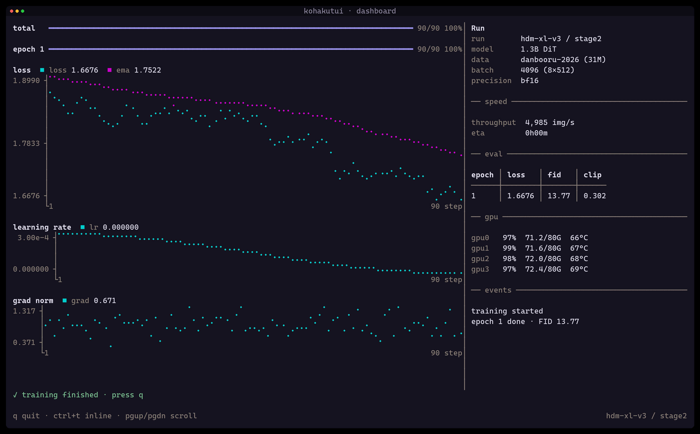
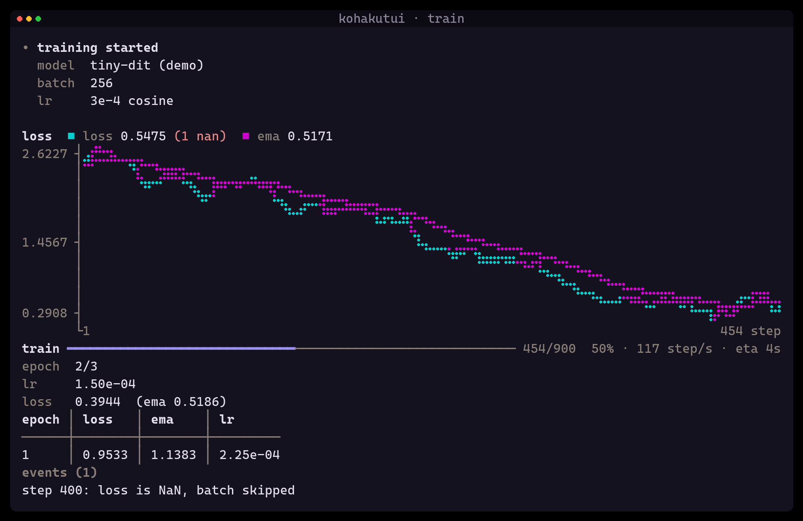
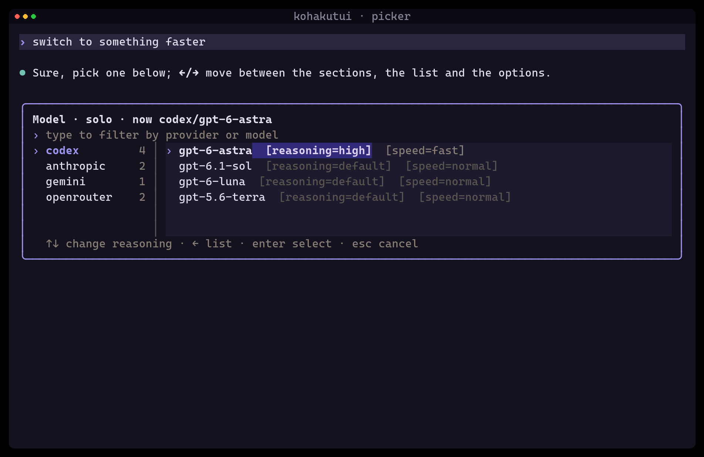
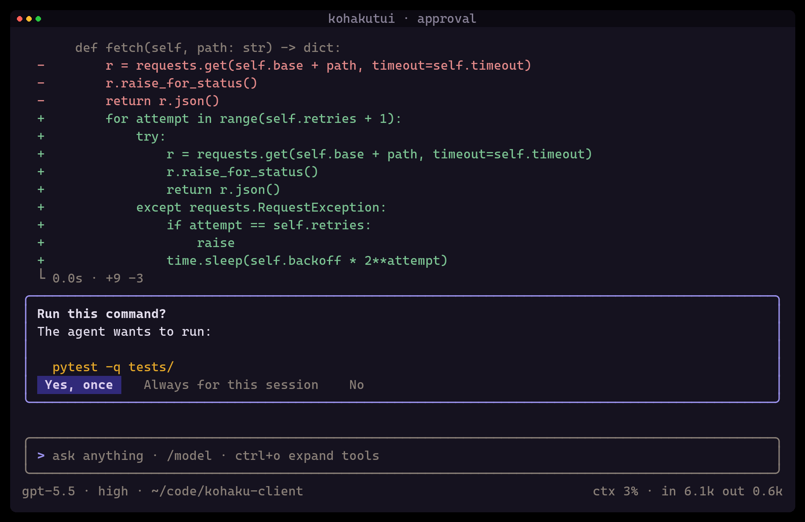
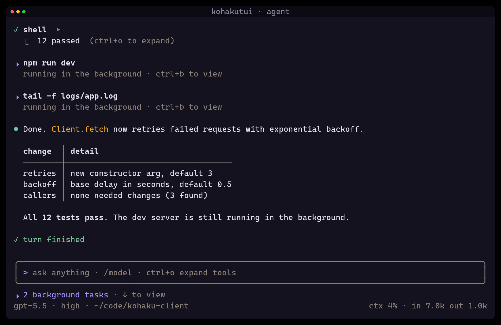

# KohakuTUI

[](https://pypi.org/project/kohakutui/)
[](https://pypi.org/project/kohakutui/)
[](LICENSE)

**Terminal UIs for Python, rendered by Rust.** Training monitors, dashboards, interactive CLI
tools, log viewers, chat front ends: describe *what* is on screen as a tree of nodes, and the
Rust engine owns the terminal, the frame loop and every keystroke. Live output never flickers,
input stays responsive while your Python code is busy, and finished output lands in the
terminal's real scrollback, so it can be scrolled, searched and copied like any command's output.



<sub>Every image here is real output: the demos run headless and
[`scripts/screenshots.py`](scripts/screenshots.py) paints the emulated terminal's cells.</sub>

## Why

- **Inline and full screen, same code.** Inline mode keeps a small live area at the bottom and
  writes everything finished into scrollback, as `pip`, `cargo` or a training script would, only
  it can redraw. Full screen gives you panes, scrolling and the mouse. `ctrl+t` switches between
  them at runtime.
- **Rust where it matters.** Layout, wrapping, Markdown, charts, frame diffing and key reading
  run in Rust on their own thread. Python sends small batches of changes and gets meaningful
  events back (`submit`, `select`, `close`), never raw key codes.
- **Things you would otherwise build yourself.** Live charts and sparklines, progress bars with
  rate and ETA, tables, logs, streamed Markdown, foldable sections, pickers with sections and
  options, prompts, cards, a full input editor with history and commands.
- **Nothing traps the user.** Dialogs open where the input is, typing keeps working, and esc
  always gets you out.
- **Testable.** Every app runs headless on an emulated terminal (`App(backend="test")`): a test
  types keys and reads exactly what a user would see.
- **No runtime dependencies.** One abi3 wheel per platform, CPython 3.10 and newer.

## Install

```bash
pip install kohakutui
```

Wheels for Linux (x86_64, aarch64), Windows (x86_64) and macOS (Apple silicon, Intel).

## Try it

```bash
python -m kohakutui demo dashboard  # full-screen training monitor: charts, eval table, GPU panel
python -m kohakutui demo train      # inline training: live chart and progress, results in scrollback
python -m kohakutui demo chat       # streamed Markdown, an input box, a picker
python -m kohakutui demo agent      # a coding-assistant session: foldable steps, an approval card,
                                    # background tasks (↓ or ctrl+b)
python -m kohakutui reset           # fix a terminal left in raw mode
```

## Quick start

A training loop with a live chart and progress bar that leaves the final curve in scrollback:

```python
import random
import time

import kohakutui as ktui

with ktui.App() as app:
    info = ktui.KV(fields={"model": "tiny-mlp", "steps": "300", "lr": "1e-3"})
    app.transcript.add(ktui.Cell(role="system", title="run started", children=[info])).seal()

    chart = app.live.add(ktui.Chart(label="loss", height=8, unit="step"))
    bar = app.live.add(ktui.Progress(total=300, label="train", unit="step"))

    loss = 2.0
    for step in range(1, 301):
        loss = max(0.05, loss * 0.99 + random.gauss(0, 0.02))
        with app.batch():  # one frame for both changes
            chart.append(loss)
            bar.append(step)
        time.sleep(0.01)

    bar.remove()
    chart.move(app.transcript)  # the finished curve goes to scrollback
    chart.seal()
    if app.confirm(f"Final loss {loss:.3f}. Save a checkpoint?", default=True):
        app.transcript.add(ktui.Text("saved ckpt-300.pt", tone="ok")).seal()
```

The screen is five regions, each a node you add children to:

| Region | Inline mode | Full-screen mode |
| ------ | ----------- | ---------------- |
| `app.transcript` | sealed nodes go to real scrollback | the scrollable main pane |
| `app.live` | what is happening now: charts, progress, spinners | under the main pane |
| `app.bottom` | input, status rows, footer | bottom |
| `app.panels` | hidden | right-hand pane |
| `app.overlays` | dialogs | dialogs |

Nodes change with `update(**props)`, stream with `append(data)`, finish with `seal()` and move
with `move(parent)`. Input arrives as events: `@app.on(kind, node)`, `for ev in app.events()`
or `async for ev in app.aevents()`. The [getting started guide](docs/getting-started.md) builds
an interactive app step by step.

## Gallery

<table>
<tr>
<td width="50%"></td>
<td width="50%"></td>
</tr>
<tr>
<td><b>Inline live area.</b> The chart, progress, stats and epoch table redraw in place; the
run's header is already in scrollback above them, and the final results go there once.</td>
<td><b>Pickers.</b> Fuzzy filter, a section sidebar, per-item options and focus areas: ←/→
move between sections, list and options, ↑↓ act on the focused one.</td>
</tr>
<tr>
<td></td>
<td></td>
</tr>
<tr>
<td><b>Dialogs that never trap.</b> A card, question or picker opens where the input box is;
esc gives the input back, and the program keeps running behind it.</td>
<td><b>Chat and assistant front ends.</b> Streamed Markdown, foldable steps (ctrl+o), grouped
tool calls and background tasks under the input.</td>
</tr>
</table>

## Features

- **Data**: line charts over a whole run, sparklines, progress bars with rate and ETA, tables,
  key/value lists, scrolling logs (`\r` progress lines work), code blocks.
- **Text**: Markdown (streamed or whole), styled text, foldable cells with summaries, scroll
  boxes, grouped entries ("5 tool calls"-style batches).
- **Input**: a multi-line input box with history and a command popup, buttons and segmented
  rows, pickers (filter, sections, multi-select, options), prompts (also secret input),
  confirmations, cards.
- **Full screen**: wheel scrolling, clickable and keyboard-navigable folds, hover, drag to select
  and copy (OSC 52), a side panel.
- **Themes**: eight schemes (`kohaku-dark`, `kohaku-light`, `tokyo-night`, `solarized-*`,
  `colorblind-*`, `terminal`), truecolor with a 256-colour fallback, switchable at runtime.
- **Capture**: `print` and `logging` output goes into the transcript instead of tearing the
  screen (`app.capture_stdio()`, `app.capture_logging()`).
- **Threads and asyncio**: any thread may update the screen; dialogs have blocking and `await`
  forms.

## Documentation

| Page | What it covers |
| ---- | -------------- |
| [Getting started](docs/getting-started.md) | Install, a first interactive app, modes, events, threads and asyncio |
| [Concepts](docs/concepts.md) | Regions, nodes, sealing and scrollback, how a frame is made |
| [Components](docs/components.md) | Every component and its props |
| [Dialogs and input](docs/dialogs.md) | Pickers, prompts, cards, docking, keys |
| [Themes](docs/themes.md) | Schemes, colour roles, overrides, truecolor |
| [Testing](docs/testing.md) | The headless backend: inject input, read the screen, screenshots |
| [Releasing](docs/releasing.md) | CI, nightlies, stable releases, PyPI trusted publishing |

KohakuTUI drives the terminal front end of
[KohakuTerrarium](https://github.com/KohakuBlueleaf/KohakuTerrarium), and is planned for the
CLI of [KohakuBoard](https://github.com/KohakuBlueleaf/KohakuBoard).

## Development

Requires a stable Rust toolchain and Python 3.10+.

```bash
uv venv
uv pip install -e ".[dev]"     # maturin builds kohakutui._rs into the venv
python -c "import kohakutui; print(kohakutui.version())"
```

After changing Rust code, run `uv pip install -e ".[dev]"` again (or `maturin develop`).

```bash
pytest tests/ -q                                     # Python: unit, integration, e2e, static
cargo test --no-default-features                     # Rust: every stage
cargo fmt --check && cargo clippy --all-targets --features python -- -D warnings
black --check src/ tests/ scripts/ && ruff check src/ tests/ scripts/
uv run --with pillow --with fonttools python scripts/screenshots.py   # regenerate the images
```

```text
src/kohakutui-rust/   the engine crate (kohakutui._rs with the `python` feature)
src/kohakutui/        the Python SDK
tests/                static contracts + e2e / integration / unit (see tests/README.md)
docs/                 user documentation and the README images
scripts/              release versioning, screenshots
```

Contributor rules are in [`CLAUDE.md`](CLAUDE.md).

## License

Apache-2.0. See [`LICENSE`](LICENSE).
